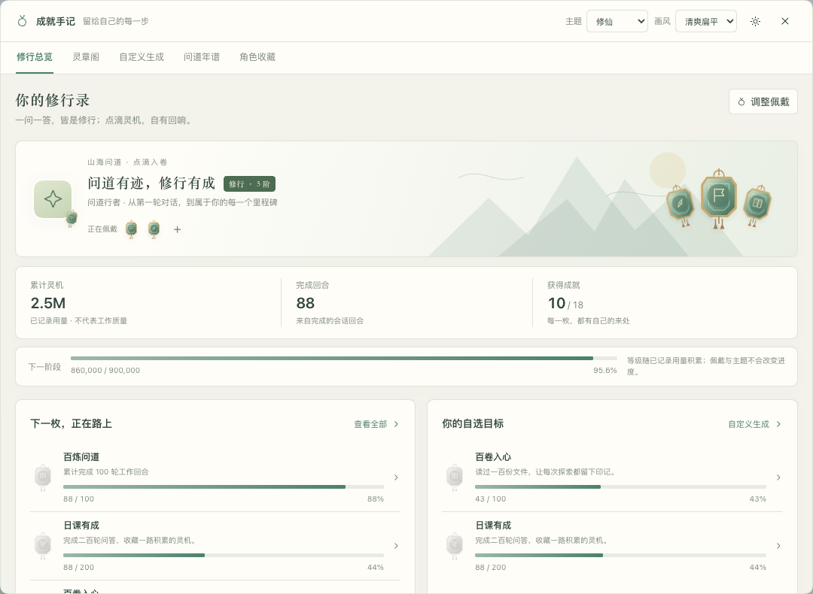
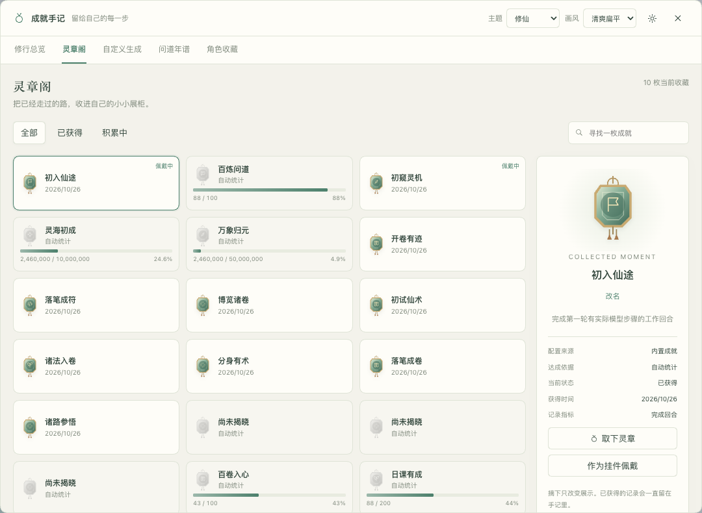
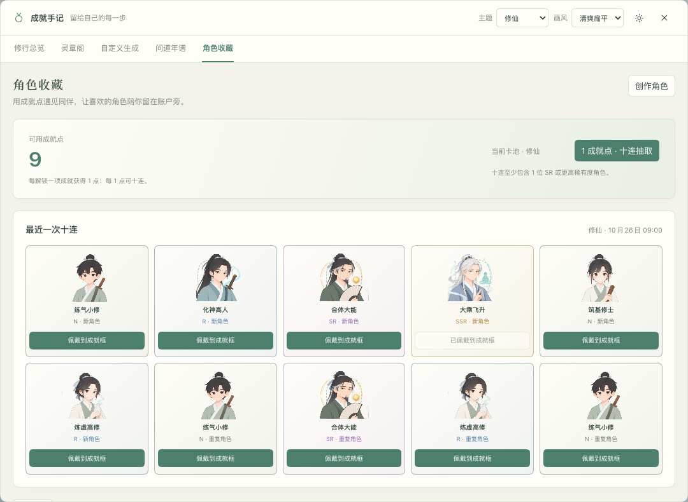
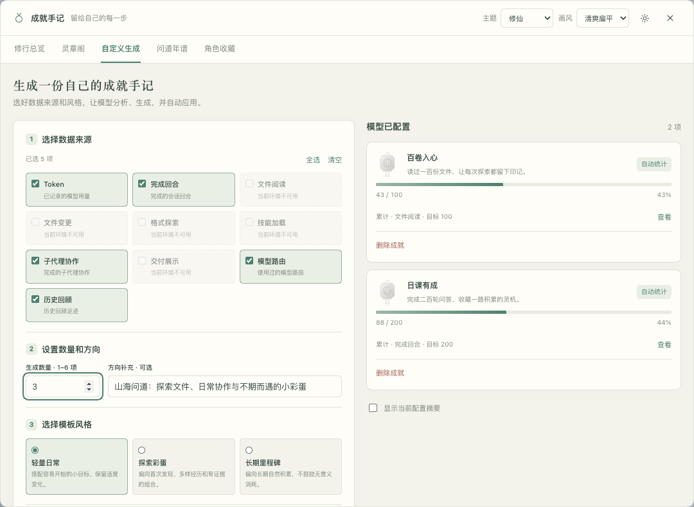
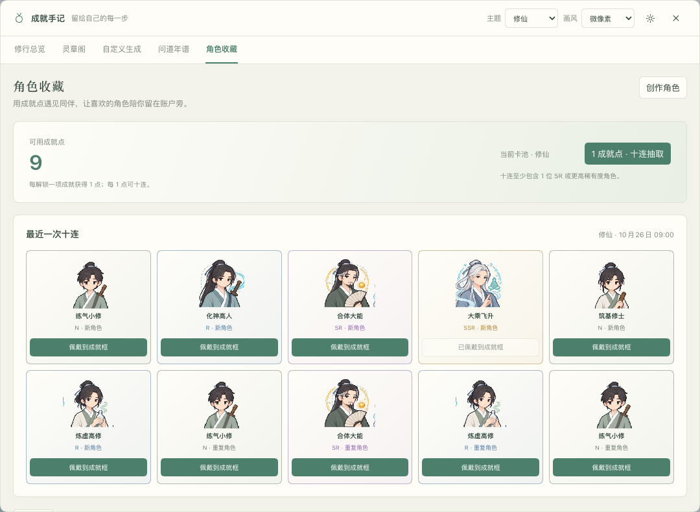
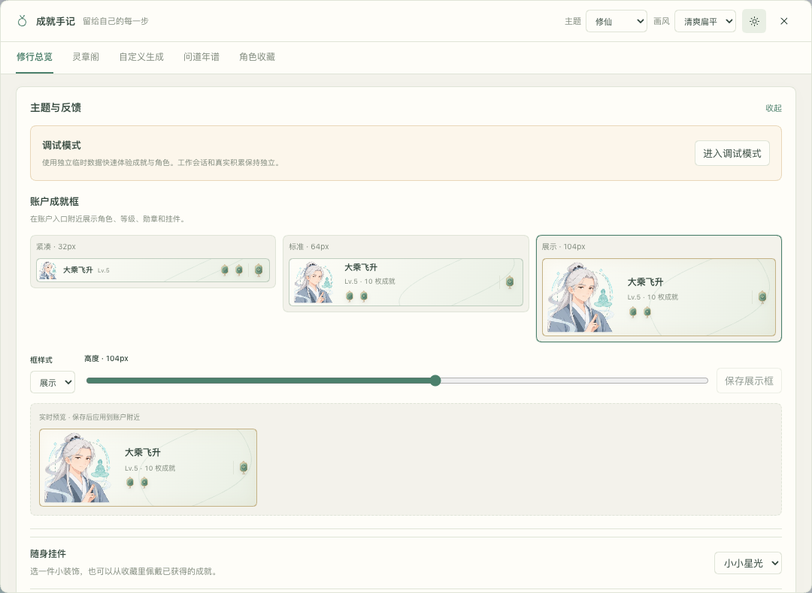

# DSH Achievement Helper · 成就手记

`dsh-achievement-helper` 是一个轻量的个人成就插件。真实使用积累、文件探索、技能与委派等经历可以变成主题成就；勋章、挂件与历程保存在本地。发布状态以对应GitHub Release和npm版本元数据为准；本地构建不代表公开发行。

支持探索、修仙、赛博朋克、武侠、奇幻、星际、深海、花园、学院和蒸汽十套主题。顶部只保留一个主题选择，成就文案、角色卡池、抽卡、自定义生成和调试抽取都使用当前主题。获得记录和收藏保持稳定，展示框只展示当前主题的已佩戴角色；未更换佩戴时，切回该主题恢复显示。日常记录、抽卡和反馈不调用模型；只有点击模型生成按钮才发起一次有界的辅助请求。

## 实际效果

下面是 0.2.0 的实际界面，使用独立环境中的合成演示档案。图中进度和抽取结果用于展示功能；首次安装从空档案开始，抽取概率以页面显示的规则为准。

成长总览把等级、使用积累、佩戴勋章和下一项成就放在一起。主题切换会改变文案与外观，已有进度继续保留。



成就收藏使用紧凑卡片，展示已解锁勋章、条件和当前进度。可以筛选、查看详情和调整佩戴。



成就点用于十连抽取主题角色，结果可直接佩戴到成就框；卡池同时展示稀有度、逐卡概率和 SSR 保底进度。这里展示修仙题材的清爽扁平画风。



自定义生成只需勾选数据来源、设置数量和方向，再选择模板风格。点击生成才调用模型，校验通过后自动加入手记；截图仅填写表单，没有发起模型请求。



<details>
<summary>查看微像素画风与账户展示框</summary>

同一套角色也可以切换为微像素画风，收藏和稀有度保持不变。



账户附近的展示框有紧凑、标准、展示三种预设，也支持自定义高度。角色、勋章和挂件可以在保存前实时预览。



</details>

截图来源与公开范围见[素材说明](docs/images/README.md)。

## 使用

在 DSH 侧栏底部、账户区域旁的展示框打开「成就手记」，或在设置中打开同名页。首次安装为空档案，完成新的工作回合后开始积累。概览查看等级与最近获得；收藏查看条件与佩戴，成就卡采用紧凑布局，图标和卡片高度约为早期版本的一半；历程记录获得和升级。主题与反馈设置提供紧凑32px、标准64px、展示104px和32～160px自定高度，选择时实时预览、保存后应用。反馈可设为全部、仅解锁或关闭，并可减少动画；布局适应窄窗口和浏览器缩放。

每枚已解锁的唯一成就提供1点，已有成就自动计入；1点十连，重复角色累计份数，不返还点数。基础概率N60%、R28%、SR10%、SSR2%，同主题同稀有度角色均分该概率；若十连没有SR及以上，第十张按SR:SSR=10:2重新选择。同主题最多50张必得SSR，抽中任何SSR立即重新计数；各题材保底独立，切换画风不重置。卡池逐张展示基础单抽概率和下一次十连的平均单张概率，后者包含当前保底状态，不表示十连至少获得一次的概率；加入自定义角色后自动重新计算。保底只保证稀有度，不指定某个角色。这是不含付费购买的本地个人收藏。切主题、抽卡或创建角色不产生成就点，模型不能修改余额或直接授予角色。

角色收藏页可抽卡、查看稀有度、选择已获角色佩戴；切主题保留角色收藏。创作区支持模型自动生成同主题角色的名字、图标、稀有度和动画预设，也可手工配置并上传本地PNG/JPEG/GIF/WebP（每张不超过256KiB）。上传素材只保存在当前本机档案，不发给模型或远端；不接受脚本、SVG或远程图片地址。创建先加入卡池，抽中后才能佩戴；已获自定义角色可改外观，主题与稀有度保持。减少动画时角色使用静态表现。

预设角色用各题材常见职业或等级命名，修仙依次为练气小修、筑基修士、结丹真修、元婴真人、化神高人、炼虚高修、合体大能、大乘飞升。名字与稀有度对应，既有角色ID、份数、稀有度和自定义名字保留。模型生成也优先使用题材职业/等级，可按明确要求创作法宝或使用自定名字。

80个预设角色各有「清爽扁平」「微像素」两种外观，采用内置图片生成工具制作，共20张本地透明图集。顶部「画风」选择与题材独立，列表、抽取结果、创作预览和账户框同步切换；角色ID、稀有度、份数、积分与抽取概率保持。高阶角色增加相称且克制的题材特效。自定义角色未上传图片时使用当前题材和画风的默认立绘，上传图片始终优先且保留原画风。十连结果可直接佩戴；框内沿用轻浮动、呼吸等动态，减少动画设置会停止动态。内置像素图按像素方式缩放，其他图片保持原表现。

「自定义生成」页勾选数据源、填写主题方向与模板风格，设置本次数量（1～6项，默认3项），然后点击「分析并生成成就」。结果必须恰好符合所选数量才会加入档案，不足或超出会明确报错。插件使用当前会话选中的模型，没有当前会话时使用DSH默认模型；不会把主会话历史发送给生成模型。生成结果经结构校验后直接加入档案，无需复制提示词或逐项确认。正常模型用量与实际来源会显示在生成回执里，未知用量不会补零。

所有预设和自定义成就、角色均支持独立改名。成就详情或角色卡片点击「改名」，保存最多60字的名称；自定义名称在各主题中优先显示，也会应用到历史、佩戴和抽取结果。点击「恢复原名」重新使用题材默认名称。改名不改变规则、进度、历史原始记录、积分或收藏；角色原图与稀有度保持。

自定义成就可以在列表中删除，删除前就地确认。删除会停止后续进度、从列表和佩戴中移除，已获得的历史和成就点仍然保留，也不退还已花费的点数。底层保留不可复活的归档身份，以免重复授权或损坏历史引用；重新创作会产生新的成就。内置成就不提供删除。

## 调试模式

在主题与反馈设置中点击「进入调试模式」。插件复制当时真实档案到独立临时目录，显示持续横幅与框内「调试」标记。可以快速完成单项/全部成就、十连并自动佩戴、加挂件，也可在调试档案中体验普通佩戴与设置。积分、成就、角色和挂件都只保存在调试副本。

「重置调试数据」会换一份当前真实档案的干净副本，旧调试请求立即失效；「退出调试」清理副本并回到真实数据。真实工作回合和模型工具不跟随页面模式切换，仍正常写真实档案。调试不调用模型生成，避免为体验消耗模型用量；重启或30分钟到期后旧调试会话失效，需要显式退出或重新进入。

调试档案带独立标记，普通真实实例拒绝加载，不能导入/合并到真实档案。切换后的旧响应不会覆盖新模式，过期请求不会自动降级到真实写入。最多保留4个临时调试会话，退出或卸载会排空并清理各自目录。

也仍可在正常会话中告诉模型：

> 给我配置一套修仙成就，包含探索、协作和这个项目的纪念。先查询成就目录，只配置当前支持的条件。

模型通过四个固定工具工作：`achievement_catalog`、`achievement_query`、`achievement_configure`、`achievement_report`。`configure`可分别配置成就或角色卡池，查询角色时不包含上传图片。目录说明实际来源与覆盖；自动事实由插件判定，模型报告和用户记录单独标源。模型不能写原始token、抽卡、修改成就点或直接授予角色及自动成就。

## 数据与边界

只记录启用后的可见活动，不自动导入旧会话。缺 usage 是未知，不推断为零。fork 继承、重复事实和请求重试去重；顺序组合要求可证明的步骤依赖，不拿并发结果的日志排列当执行顺序。命令结束不代表测试通过，文件交付不等于用户验收，Skill 加载不等于正确应用。

档案位于当前 DSH_HOME 的 `storages/achievement-journal/`，含本地身份盐、规则、去重水位、聚合、获得历史和佩戴；不复制源码、会话正文、命令参数或报告正文。生成回执另保留有界任务身份、模型、用量、结果ID和终态，不保存方向文本或原始模型输出。定义标题和说明由用户/模型配置，避免把秘密写入这些字段。只有原子持久化成功的变化才通知。损坏或写失败不会静默清空收藏。

一键生成可取消，应用阶段开始后不再承诺撤销。取消、超时、截断或不合格输出不会应用；重启不自动重发模型请求。后台计数变化只重试本地保存，定义或主题被其他操作修改时保留新配置并拒绝旧生成结果。辅助生成已证明的 token 会单独入账，不伪造完成回合。

生成启动响应不明时，先沿用原请求确认，不能通过修改数量或方向另开一次任务；已接收的请求只返回原回执。未确认的请求暂存当前浏览器标签页的sessionStorage，便于刷新后仍用原ID，确认后移除。抽卡遇到网络或持久性不明也保留原请求重试，明确未扣点的主题冲突或余额不足则允许重新选择。

辅助生成在真正派发前取消，不会记录一次未知模型用量；已经派发或崩溃时无法证明是否派发的调用仍保守保留用量未知。切换画风只改变外观，不改变生成任务的题材/规则或自动取消它。

首次安装增加四项模型工具；角色参数在上一候选扩展，本次调试只供浏览器使用，不注册调试模型工具。安装或升级建议在任务间隙使用独立web profile。主题、佩戴或定义修改不会再注册工具；计数、抽卡和调试不调用模型，生成使用正常模型用量。

## 安装与卸载

0.2.0 已通过 [GitHub Release](https://github.com/ghang/dsh-achievement-helper/releases/tag/v0.2.0) 和 [npm](https://www.npmjs.com/package/dsh-achievement-helper/v/0.2.0) 发布。首次安装到 `web` profile：

```sh
dsh plugin --profile web add dsh-achievement-helper@0.2.0
```

也可下载 Release 中的预构建 tgz 后安装：

```sh
dsh plugin --profile web add /absolute/path/dsh-achievement-helper-0.2.0.tgz
```

包名从开发期的 `dsh-achievement-journal` 改为 `dsh-achievement-helper`。已有旧包时，在空闲回合停宿主并备份插件专属存储，先移除旧包再装新包，保留原存储；不要同时启用两个包。新包沿用旧Cordis身份、存储目录、浏览器重试键和四项模型工具，旧HTTP入口兼容到新入口。

```sh
dsh plugin --profile web remove dsh-achievement-journal
dsh plugin --profile web add /absolute/path/dsh-achievement-helper-0.2.0.tgz
```

插件榜收录单独办理；发布步骤见[RELEASING](docs/RELEASING.md)，首版说明见[0.2.0](docs/releases/0.2.0.md)。卸载：

```sh
dsh plugin --profile web remove dsh-achievement-helper
```

卸载停止工具、事件观察和界面，清理其调试副本；真实档案保留，重装可恢复。本版沿用schema v2，已有v2不因读取或后台事实而补写画风默认值；首次保存偏好后写入新字段portraitStyle。旧v1首次升级保留成就、去重、佩戴与偏好并补计点数。升级前备份整个插件专属存储：首次成功改名会写入可选displayNames覆盖和永久请求去重记录，旧rc.4及之前严格reader不能读取；即使恢复原名，rename请求记录仍保留，也不能直接降级。只读取旧档案不会补写改名数据。旧抽卡记录参与保底计数，不补发或重算历史结果；超过50张的旧连败记录从下一张兑现SSR。首次偏好保存写入portraitStyle后，旧rc.3也无法读取主档案；安全降级需停宿主并恢复配套完整备份，不可覆盖之后新活动。需要清除个人档案时先停宿主、备份后移除专用存储目录，不修改Session真源。没有历史导入或跨设备合并。

## 开发与验证

使用 Node 22.19 或 24+。`node scripts/install-dev.mjs` 使用空配置和官方源安装锁定开发依赖，`npm test` 验证领域、采集、工具与 HTTP 集成；`npm run build` 干净构建；`npm run check:package` 完整验证源码、构建及实际 tgz 的关键集成。不要在指向运行 profile 的依赖软链上执行安装或构建。

测试只使用合成记录和本机假上游。源码测试与真实宿主安装、浏览器验证分开留证；本地候选不等于公开发行或收费模型质量验收。
